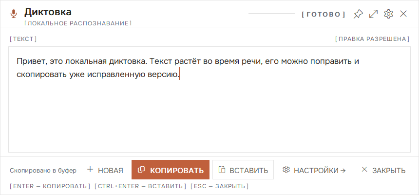
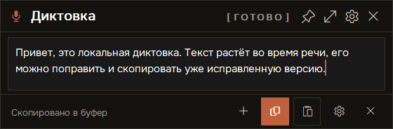
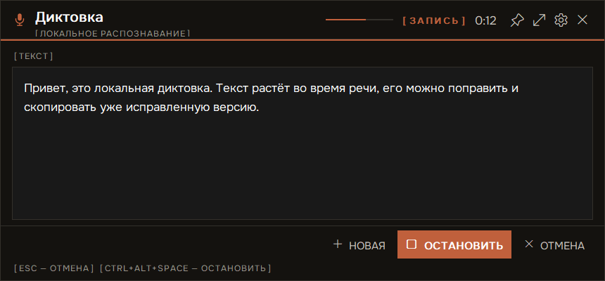
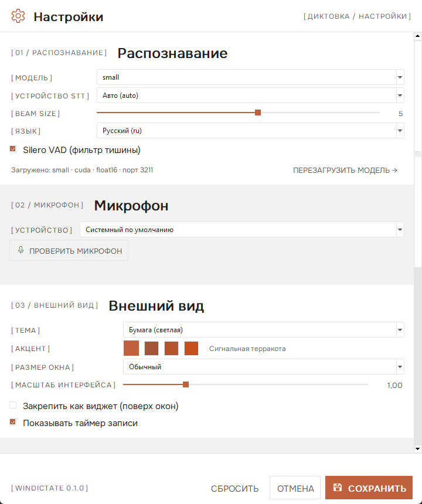

# WinDictate

**Local, offline voice dictation for Windows.** Press a global hotkey, speak — text appears in
a floating window while you are still talking. Edit it, copy it, or paste it into the app you
were working in. Everything runs on your machine: no cloud, no accounts, no telemetry.

[](https://github.com/storyartpro/windictate/actions/workflows/ci.yml)
[](LICENSE)
[](https://github.com/storyartpro/windictate/releases)

> Русская версия: [README.ru.md](README.ru.md)



## Features

- **Global hotkey** — `Ctrl+Alt+Space` starts and stops dictation from any application.
- **Live transcript** — partial faster-whisper passes every ~0.9 s render the growing draft;
  after a short pause the phrase is finalised with a more accurate pass.
- **Edit before you copy** — the transcript is an editable field; copy/paste always uses the
  version you see (wrong names and numbers can be fixed in place).
- **New dictation** — one button clears the text and starts recording again, even mid-recording.
- **Copy & paste** — `Enter` copies, `Ctrl+Enter` pastes into the previously active window,
  `Esc` cancels.
- **Floating window** — drag it anywhere (position is remembered), pin it as an always-on-top
  widget, choose compact / normal / wide layouts.
- **Detailed settings** — model (tiny … large-v3-turbo), CUDA or CPU, beam size, VAD, language,
  microphone, light/dark theme, accent, UI scale, hotkeys, auto-copy, history, autostart.
- **Model reload** — switch model or device and reload without restarting the app.
- **Safe settings** — if a hotkey is already taken, the previous working hotkey stays active and
  the settings window tells you which combination is free.
- **Portable mode** — unpack the ZIP anywhere; the launcher bootstraps its own Python
  environment and keeps settings, history and logs inside the folder.
- **No leftovers** — the speech model runs in a child process in a Windows Job Object; it is
  terminated even if the app crashes.

| Compact | Dark theme | Settings |
|---|---|---|
|  |  |  |

## Requirements

- Windows 10/11 x64
- [uv](https://docs.astral.sh/uv/) — used once to create the Python environment
  (the launcher runs it automatically on first start)
- Optional: NVIDIA GPU with CUDA 12 for fast recognition (CPU works too, just slower)
- ~1.5 GB of disk for the Python environment with CUDA libraries; models are downloaded
  once into the HuggingFace cache (`%USERPROFILE%\.cache\huggingface`)

## Install (recommended: portable)

1. Download **`WinDictate-portable.zip`** from [Releases](https://github.com/storyartpro/windictate/releases).
2. Unpack it into a folder where you have write access (for example
   `C:\Users\<you>\Apps\WinDictate`; not `Program Files`).
3. Run **`WinDictate.exe`**. On the first start it creates `runtime\` (Python 3.11 +
   faster-whisper, sounddevice, pystray, pillow; CUDA 12 libraries if an NVIDIA GPU is found)
   and then starts dictation. This takes a few minutes once.
   You can also run `bootstrap.cmd` manually to prepare the environment first.

Settings, history and logs live in `<folder>\data`. Delete the folder to uninstall.

### Developer install (to `%LOCALAPPDATA%`)

```powershell
powershell -NoProfile -ExecutionPolicy Bypass -File .\scripts\install.ps1
```

This copies the app to `%LOCALAPPDATA%\WinDictate`, creates the Python environment, adds
Desktop/Start-menu shortcuts, enables autostart and registers an uninstall entry.

## Usage

| Keys | Action |
|---|---|
| `Ctrl+Alt+Space` | Start / stop dictation (global) |
| `Ctrl+Alt+S` | Open settings |
| `Enter` | Copy the transcript (in widget mode — without closing) |
| `Ctrl+Enter` | Copy and paste into the previously active window |
| `Esc` | Cancel recording / hide the window |
| `Shift+Enter` | New line while editing |

Recording never stops on silence — only on the second press, `Esc`, or the recording cap
(10 minutes by default). Everything is configurable in the settings window.

### `WinDictate.exe` commands

| Command | Action |
|---|---|
| `WinDictate.exe` | Start; if already running, offer a restart |
| `--start` / `--stop` / `--restart` | Control the background app |
| `--status` | Exit code `0` = running, `10` = stopped |
| `--settings` / `--open` | Open settings / the dictation window |
| `--version` / `--help` | Version / help |

## Settings

- **Recognition** — model, device (Auto / GPU / CPU), beam size 1–8, VAD, language; shows the
  loaded model and lets you reload it.
- **Microphone** — input device and a 3-second test with level and recognised text.
- **Appearance** — light/dark theme, accent (terracotta palette), window size, UI scale,
  widget mode, timer.
- **Controls** — dictation and settings hotkeys, reset to defaults.
- **Behaviour** — auto-copy, Ctrl+Enter paste, single line, history limit, autostart.
- **About** — version, data folder, logs.

Settings are applied transactionally: a busy hotkey never replaces a working one, and the
reason is shown right in the settings window.

## How it works

```
hotkey → Tk window → sounddevice PCM capture → DictationEngine (partial/final passes)
       → faster-whisper sidecar on 127.0.0.1:3211+ → editable text → clipboard / Ctrl+V
```

See [docs/ARCHITECTURE.md](docs/ARCHITECTURE.md) for the full picture, the streaming
constants and the sidecar lifecycle.

**Privacy:** audio never leaves the machine; the sidecar listens on loopback only and the app
makes no outbound requests except the one-time model download by the HuggingFace cache.

## Build from source

```powershell
# 1. Python environment
uv venv --python 3.11 .venv
uv pip install --python .venv\Scripts\python.exe faster-whisper==1.2.1 sounddevice numpy pystray pillow

# 2. Run tests
.venv\Scripts\python.exe tests\test_core.py
.venv\Scripts\python.exe tests\test_shell.py

# 3. Build the launcher and the portable ZIP
powershell -NoProfile -ExecutionPolicy Bypass -File scripts\build-launcher.ps1
powershell -NoProfile -ExecutionPolicy Bypass -File scripts\build-portable.ps1
# → dist\WinDictate.exe, dist\WinDictate-portable.zip
```

`scripts\build-portable.ps1` only copies the app and compiles the small C# launcher
(`csc.exe` from .NET Framework, no SDK needed); the Python environment is created on the
user's machine on first run. `scripts\install.ps1` installs a local copy to `%LOCALAPPDATA%`.

## Project layout

```
app.py                    entry point (Tk app, tray, CLI flags, selftest)
dictate/                  config, engine, audio, STT client, hotkeys, theme, UI, tray, Win32 helpers
server/stt_server.py      local faster-whisper sidecar (stdlib HTTP)
scripts/                  launcher source, portable/install/build scripts
assets/                   fonts (Onest, OFL) and app icons
tests/                    headless tests, live GUI test, screenshot tool
docs/                     architecture notes
```

## Troubleshooting

- **Nothing is recognised** — Settings → Microphone → test; check `data\logs\stt.log`.
- **Hotkey does nothing** — likely taken by another app; Settings → Controls shows the conflict
  and suggests a free combination.
- **Slow recognition** — use a smaller model or enable CUDA (Settings → Recognition).
- **Window does not appear** — check `data\logs\app.log`; restart with
  `WinDictate.exe --restart`.

## License

[MIT](LICENSE). Bundled typesetting font **Onest** is licensed under the SIL Open Font
License ([assets/fonts/Onest-OFL.txt](assets/fonts/Onest-OFL.txt)). UI icons are Windows
system glyphs (Segoe Fluent Icons / Segoe MDL2 Assets). Speech recognition is powered by
[faster-whisper](https://github.com/SYSTRAN/faster-whisper).
