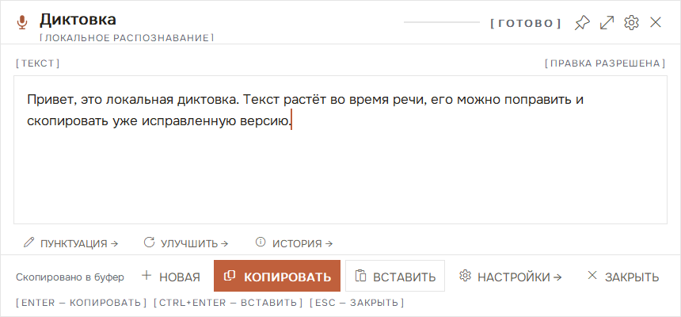
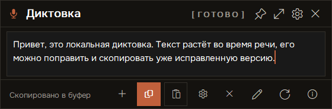
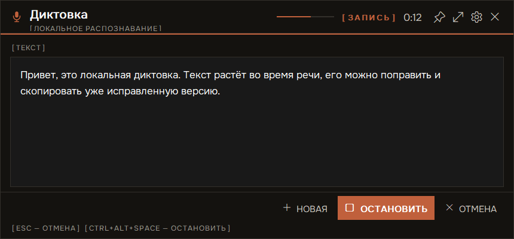
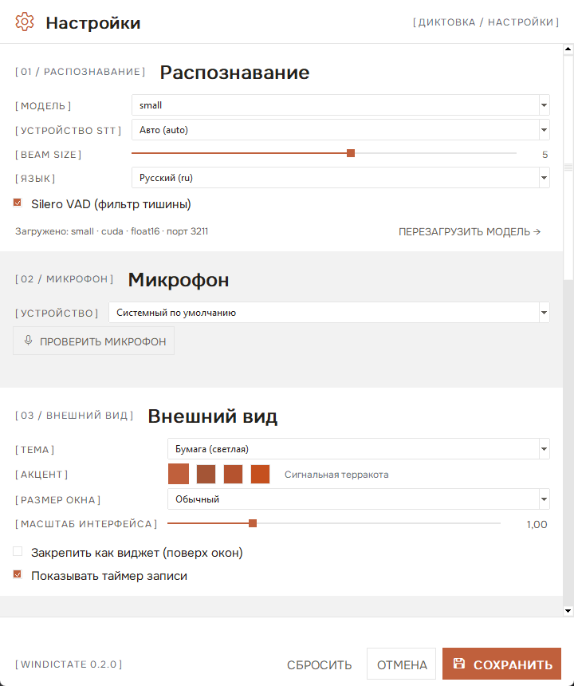
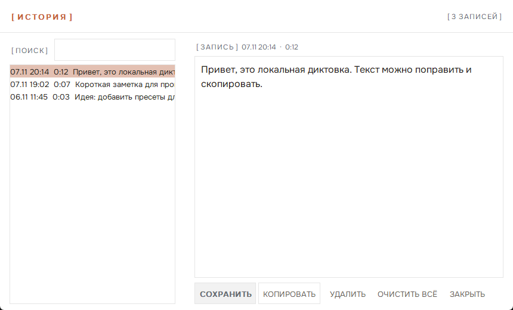
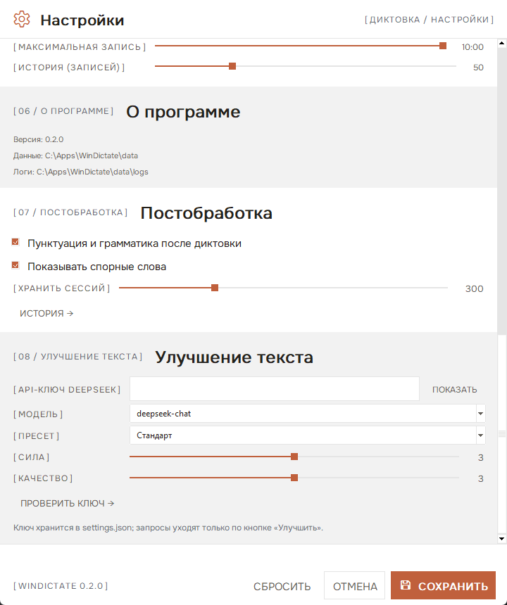

# WinDictate — локальная диктовка для Windows

**Офлайн-диктовка прямо на вашем компьютере.** Нажимаете глобальную горячую клавишу и говорите —
текст появляется в плавающем окне, пока вы ещё говорите. Текст можно поправить, скопировать
или вставить в то приложение, где вы работали. Всё считается локально: без облака, аккаунтов
и телеметрии (необязательная кнопка «Улучшить» обращается к DeepSeek API только при наличии
вашего ключа).

[](https://github.com/storyartpro/windictate/actions/workflows/ci.yml)
[](LICENSE)
[](https://github.com/storyartpro/windictate/releases)

> English version: [README.md](README.md)



## Возможности

- **Глобальная горячая клавиша** — `Ctrl+Alt+Space` запускает и останавливает диктовку
  из любого приложения.
- **Живой текст** — промежуточные проходы faster-whisper примерно раз в 0,9 с показывают
  растущий черновик; после паузы фраза фиксируется более точным проходом.
- **Правка до копирования** — текст в окне редактируется; копируется именно та версия,
  которую вы видите (имена и цифры можно поправить на месте).
- **История сессий** — каждая диктовка сохраняется с временем, длительностью и моделью. Окно
  истории позволяет искать, открывать, править, копировать, удалять и очищать записи; старые
  сессии обрезаются автоматически (300 по умолчанию, настраивается).
- **Постобработка** — после диктовки расставляются пунктуация, заглавные буквы, тире, безопасные
  запятые и исправляются частые грамматические огрехи (отменяется по `Ctrl+Z`).
- **«Спорные» слова** — подозрительные фрагменты (`-ться/-тся`, слитное «не», латиница внутри
  кириллицы, частые опечатки) предлагаются вариантами на подтверждение и не меняются молча.
- **«Улучшить» через DeepSeek** — отправляет текущий текст в DeepSeek API и заменяет его
  улучшенной версией; пресеты (Мягко / Стандарт / Сильно), ползунки силы и качества, выбор
  модели и API-ключ в настройках.
- **«Новая»** — одна кнопка очищает текст и сразу начинает новую диктовку, в том числе во
  время записи.
- **Копирование и вставка** — `Enter` копирует, `Ctrl+Enter` вставляет в предыдущее активное
  окно, `Esc` отменяет.
- **Плавающее окно** — перетаскивается в любое место (позиция запоминается), закрепляется
  поверх всех окон как виджет, три размера: компактный / обычный / широкий.
- **Детальные настройки** — модель (tiny … large-v3-turbo), CUDA или CPU, beam, VAD, язык,
  микрофон, светлая/тёмная тема, акцент, масштаб, горячие клавиши, автокопирование, история,
  автозапуск.
- **Перезагрузка модели** — смена модели или устройства применяется без перезапуска программы.
- **Безопасные настройки** — если сочетание клавиш занято, прежняя рабочая клавиша остаётся
  действующей, а окно настроек подскажет свободное сочетание.
- **Портативный режим** — распакуйте ZIP в любую папку: лаунчер сам создаст окружение Python,
  а настройки, история и логи останутся внутри папки.
- **Без «хвостов»** — модель распознавания работает в дочернем процессе в Windows Job Object
  и завершается вместе с приложением, даже если оно упало.

| Компактный вид | Тёмная тема | Настройки |
|---|---|---|
|  |  |  |

| История сессий | Настройки DeepSeek |
|---|---|
|  |  |

## Требования

- Windows 10/11 x64
- [uv](https://docs.astral.sh/uv/) — нужен один раз для создания окружения Python
  (лаунчер запускает его сам при первом старте)
- По желанию: NVIDIA GPU с CUDA 12 для быстрого распознавания (CPU тоже работает, медленнее)
- По желанию: [API-ключ DeepSeek](https://platform.deepseek.com/) для кнопки «Улучшить»
- ~1,5 ГБ на диске для окружения с CUDA-библиотеками; модели скачиваются один раз в кэш
  HuggingFace (`%USERPROFILE%\.cache\huggingface`)

## Установка (рекомендуется: портативная версия)

1. Скачайте **`WinDictate-portable.zip`** из [Releases](https://github.com/storyartpro/windictate/releases).
2. Распакуйте в папку, куда есть права записи (например, `C:\Users\<вы>\Apps\WinDictate`;
   не в `Program Files`).
3. Запустите **`WinDictate.exe`**. При первом запуске он создаст `runtime\` (Python 3.11 +
   faster-whisper, sounddevice, pystray, pillow; при наличии NVIDIA GPU — библиотеки CUDA 12)
   и запустит диктовку. Это займёт несколько минут один раз.
   Можно подготовить окружение заранее: `bootstrap.cmd`.

Настройки, история и логи лежат в `<папка>\data`. Удаление — просто удалить папку.

### Установка для разработки (в `%LOCALAPPDATA%`)

```powershell
powershell -NoProfile -ExecutionPolicy Bypass -File .\scripts\install.ps1
```

Скрипт копирует приложение в `%LOCALAPPDATA%\WinDictate`, создаёт окружение Python, добавляет
ярлыки на Рабочий стол и в «Пуск», включает автозапуск и запись в «Программах и компонентах».

## Как пользоваться

| Клавиши | Действие |
|---|---|
| `Ctrl+Alt+Space` | Начать / остановить диктовку (глобально) |
| `Ctrl+Alt+S` | Открыть настройки |
| `Enter` | Скопировать текст (в режиме виджета — не закрывая окно) |
| `Ctrl+Enter` | Скопировать и вставить в предыдущее активное окно |
| `Esc` | Отменить запись / скрыть окно |
| `Shift+Enter` | Перенос строки при редактировании |

Запись не останавливается на тишине — только повторной клавишей, `Esc` или лимитом
(по умолчанию 10 минут). Всё меняется в настройках.

После диктовки в окне появляется строка действий:

- **ПУНКТУАЦИЯ →** — повторно прогнать пунктуацию и грамматику по текущему тексту;
- **СПОРНЫЕ СЛОВА →** — появляется, когда у постобработки есть сомнения; выберите верный вариант;
- **УЛУЧШИТЬ →** — отправить текущий текст в DeepSeek и заменить его улучшенной версией
  (нужен API-ключ в настройках → «Улучшение текста»; `Ctrl+Z` возвращает прежний текст);
- **ИСТОРИЯ →** — открыть историю сессий (она же в меню трея).

## История сессий

Каждая диктовка сохраняется в `sessions.json` (время, длительность, модель, итоговый текст).
В окне истории можно:

- искать по тексту, новые сверху;
- открыть и отредактировать текст (сохраняется кнопкой **СОХРАНИТЬ**; при закрытии или смене
  сессии с несохранёнными правками приложение спросит, сохранить ли их);
- скопировать текст, удалить одну сессию или очистить всю историю;
- хранить последние N сессий (`Хранить сессий`, 20–1000, по умолчанию 300). Старый формат
  `history.json` импортируется автоматически.

### Команды `WinDictate.exe`

| Команда | Действие |
|---|---|
| `WinDictate.exe` | Запуск; если уже работает — предложит перезапуск |
| `--start` / `--stop` / `--restart` | Управление фоновым приложением |
| `--status` | Код `0` — работает, `10` — остановлено |
| `--settings` / `--open` | Открыть настройки / окно диктовки |
| `--version` / `--help` | Версия / справка |

## Настройки

- **Распознавание** — модель, устройство (Авто / GPU / CPU), beam 1–8, VAD, язык; статус
  загруженной модели и кнопка перезагрузки.
- **Микрофон** — входное устройство и проверка (3 секунды записи, уровень, распознанный текст).
- **Внешний вид** — светлая/тёмная тема, акцент (терракотовая палитра), размер окна, масштаб,
  режим виджета, таймер.
- **Управление** — горячие клавиши диктовки и настроек, сброс к значениям по умолчанию.
- **Поведение** — автокопирование, вставка по Ctrl+Enter, одна строка, лимит истории, автозапуск.
- **Постобработка** — пунктуация/грамматика после диктовки, показ спорных слов, лимит сессий,
  открытие истории.
- **Улучшение текста** — API-ключ DeepSeek (хранится локально, в логи не пишется), модель
  (`deepseek-chat` / `deepseek-reasoner`), пресет и ползунки силы/качества, проверка ключа.
- **О программе** — версия, каталог данных, логи.

Настройки применяются транзакционно: занятая клавиша не заменяет рабочую, причина видна прямо
в окне настроек.

## Как это устроено

```
горячая клавиша → окно Tk → захват PCM (sounddevice) → DictationEngine (partial/final)
                → faster-whisper sidecar на 127.0.0.1:3211+ → текст в окне → буфер / Ctrl+V
```

Подробности — в [docs/ARCHITECTURE.md](docs/ARCHITECTURE.md): константы потоковой диктовки и
жизненный цикл sidecar.

**Приватность:** звук не покидает компьютер; sidecar слушает только loopback. Приложение само
сетевых запросов не делает: однократное скачивание модели идёт в кэш HuggingFace, а текст
отправляется в DeepSeek API **только** по кнопке «Улучшить» и только если ключ настроен. Ключ
хранится локально в `settings.json` и никогда не пишется в логи.

## Сборка из исходников

```powershell
# 1. Окружение Python
uv venv --python 3.11 .venv
uv pip install --python .venv\Scripts\python.exe faster-whisper==1.2.1 sounddevice numpy pystray pillow

# 2. Тесты
.venv\Scripts\python.exe tests\test_core.py
.venv\Scripts\python.exe tests\test_llm.py
.venv\Scripts\python.exe tests\test_shell.py

# 3. Лаунчер и портативный ZIP
powershell -NoProfile -ExecutionPolicy Bypass -File scripts\build-launcher.ps1
powershell -NoProfile -ExecutionPolicy Bypass -File scripts\build-portable.ps1
# → dist\WinDictate.exe, dist\WinDictate-portable.zip
```

`build-portable.ps1` только копирует приложение и компилирует небольшой C#-лаунчер
(`csc.exe` из .NET Framework, SDK не нужен); окружение Python создаётся на машине
пользователя при первом запуске. `install.ps1` ставит копию в `%LOCALAPPDATA%`.

## Структура проекта

```
app.py                    точка входа (Tk-приложение, трей, CLI, самопроверка)
dictate/                  конфиг, движок, звук, STT-клиент, хоткеи, тема, UI, трей, Win32
                          history.py — история сессий; postprocess.py — пунктуация/грамматика;
                          llm.py — клиент DeepSeek
server/stt_server.py      локальный faster-whisper sidecar (stdlib HTTP)
scripts/                  исходник лаунчера, сборка/установка/портативная версия
assets/                   шрифты (Onest, OFL) и иконки приложения
tests/                    headless-тесты, тесты LLM, живой GUI-тест, инструмент скриншотов
docs/                     архитектура
```

## Если что-то не работает

- **Ничего не распознаётся** — Настройки → Микрофон → проверка; затем `data\logs\stt.log`.
- **Горячая клавиша не срабатывает** — вероятно, занята другой программой; Настройки →
  Управление покажут конфликт и предложат свободное сочетание.
- **Медленно распознаёт** — модель поменьше или CUDA (Настройки → Распознавание).
- **Окно не появляется** — `data\logs\app.log`; перезапуск: `WinDictate.exe --restart`.
- **«Улучшить» пишет, что нет ключа** — откройте Настройки → «Улучшение текста», вставьте
  ключ DeepSeek и нажмите «Проверить ключ». Без ключа кнопка только предлагает настройку,
  остальное приложение работает офлайн.
- **Где прошлые диктовки?** — в окне «История» (файл `sessions.json` в каталоге данных).

## Лицензия

[MIT](LICENSE). Шрифт **Onest** распространяется по SIL Open Font License
([assets/fonts/Onest-OFL.txt](assets/fonts/Onest-OFL.txt)). Иконки интерфейса — системные
глифы Windows (Segoe Fluent Icons / Segoe MDL2 Assets). Распознавание речи —
[faster-whisper](https://github.com/SYSTRAN/faster-whisper).
